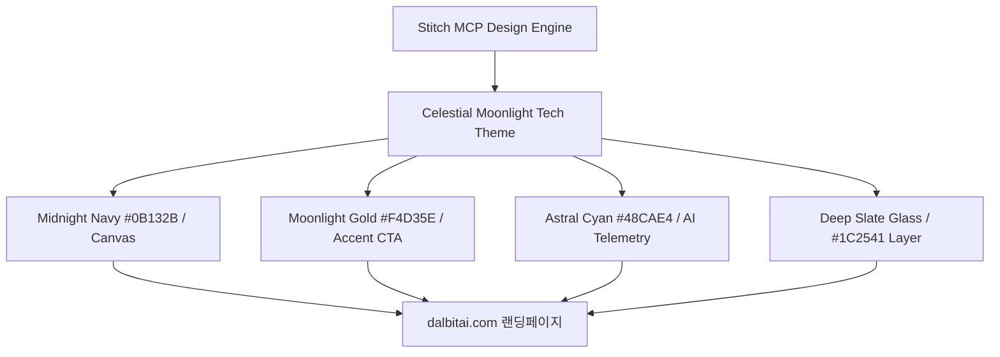
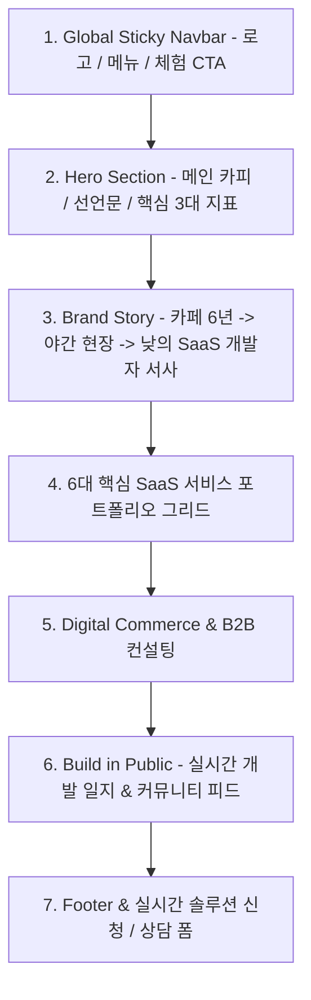

# 달빛 연구소 (dalbitai.com) 랜딩페이지 종합 구현 계획서

> **문서 버전**: v2.1 (Stitch MCP 디자인 시스템 적용본)  
> **총괄 책임자**: 안 본부장 (AI 전략 본부장)  
> **타겟 도메인**: `dalbitai.com`  
> **Stitch MCP 프로젝트 ID**: `projects/3749678419509937722`  
> **참조 문서**: `달빛_연구소_브랜드_기획서.pdf`, `dalbitai_랜딩페이지_기획서-v2.pdf`

---

## 1. 프로젝트 개요 (Executive Summary)

본 프로젝트는 **'밤의 치열함에서 태어난 실전 AI 자동화, 달빛 연구소(Moonlight Lab)'**의 정체성을 담은 플래그십 웹 포털 및 6대 자체 개발 솔루션 통합 랜딩페이지 구축을 목표로 합니다.

6년간의 오프라인 카페 자영업 경험과 야간 대리운전 현장의 생존 서사, 그리고 낮 시간 AI SaaS를 직접 코딩하고 검증한 개발자의 진정성 있는 서사를 극대화하여, 자영업자와 N잡러에게 신뢰와 효용을 제공하는 고전환율(High-Converting) 웹사이트를 완성합니다.

---

## 2. Stitch MCP 디자인 시스템 (Design Strategy)

Stitch MCP를 통해 추출된 **'Celestial Moonlight Tech'** 테마를 100% 준수합니다.

- **메인 컬러**: Midnight Navy (`#0B132B` / `#0A122A`) - 밤의 깊이와 B2B 신뢰
- **악센트 컬러**: Moonlight Gold (`#F4D35E`, `#EE9B00`) - 달빛의 희망과 CTA 버튼
- **인텔리전스 컬러**: Astral Cyan (`#48CAE4`) - AI 신경망 및 실시간 지표
- **시각 효과**: 글래스모피즘(Backdrop Blur 20px), 문라이트 골드 림 발광, 부드러운 성운 배경 애니메이션
- **타이포그래피**: `Space Grotesk` (헤드라인), `Pretendard / Inter` (본문), `JetBrains Mono` (상태 뱃지 및 지표)

---

## 3. 랜딩페이지 정보 구조 (Information Architecture)

### [섹션별 세부 기획]

| 섹션 | 핵심 내용 및 기능 | 주요 요소 |
| :--- | :--- | :--- |
| **0. Navbar** | 브랜드 아이덴티티 및 빠른 탐색 | 초승달+AI노드 로고, 메뉴 앵커 링크, [솔루션 시작] CTA |
| **1. Hero** | 첫 인상 각인 및 압도적 신뢰 형성 | 메인 헤드라인, 6년 차 카페 사장 서브카피, 달빛 연구소 창업 선언문, [대표 솔루션 체험하기] 골드 버튼, 3대 검증 지표 |
| **2. Brand Story** | 독보적인 주야간 피벗 서사 (Night & Day Pivot) | 3단계 인터랙티브 카드 (전직 6년 카페 사장 → 야간 현장 경험 → 낮의 AI SaaS 개발자) |
| **3. Portfolio** | 검증된 자체 개발 6대 서비스 라인업 | 1) 스레드 AI SaaS (`PostEverywhere AI`) 2) AI 타로 (`Tarot AI`) 3) 원두 분쇄도 측정 (`Grind Curation`) 4) 에센스커피 B2B (`Essence Coffee`) 5) 배달기사 동선 솔루션 (`Delivery Driver Loc`) 6) 대리기사 콜최적화 (`CallDrive AI`) |
| **4. Commerce & B2B** | 지식 상품 및 소상공인 솔루션 공급 | • 전자책: 스레드 자동화 50일 무한 루프 • 프롬프트 파우치: 노션 기반 AI 프롬프트 팩 • B2B 1:1 컨설팅 및 기업 출강 신청 |
| **5. Build in Public** | 개발 과정의 투명한 공개와 팬덤 형성 | 스레드/유튜브 연동 개발 일지 카드, 실시간 사용자 반응 |
| **6. Footer & Lead Form** | 고객 전환 및 사업자 신뢰 보증 | 빠른 이용 신청 팝업 모달, 사업자 등록 정보, 소셜 미디어 링크 |

---

## 4. 프론트엔드 구현 기술 명세 (Technical Specifications)

1. **단일 번들 최적화 (Vanilla Modern Web)**:
   - 외부 무거운 프레임워크 의존성을 제거하고 초고속 로딩(`LCP < 0.8s`) 달성.
   - 모던 CSS 토큰 및 CSS Custom Properties(`var(--color-primary)`) 기반 완벽한 다크 테크 글래스모피즘 구현.
2. **반응형 완벽 대응 (Responsive Design)**:
   - 데스크톱(1400px 와이드 12열 그리드), 태블릿(2열), 모바일(단일 열 스택) 완벽 지원.
3. **인터랙션 및 마이크로 애니메이션**:
   - 골드 CTA 버튼 호버 시 달빛 발광 효과 (`box-shadow glow`).
   - 서비스 카드 호버 시 3D 틸트 및 림 라이트 활성화.
   - 6대 서비스 상세 정보 및 이용 신청 모달창 내장.
   - 실시간 클립보드 복사 및 토스트 알림 기능.

---

## 5. 단계별 롤아웃 일정 (Rollout Roadmap)

- **Phase 1 (완료)**: 기획서 분석, Stitch MCP 디자인 생성, `DESIGN.md` 체계화.
- **Phase 2 (현재)**: 고품질 랜딩페이지 웹 애플리케이션 퍼블리싱 및 인터랙티브 기능 통합.
- **Phase 3**: 도메인(`dalbitai.com`) 연결 및 Vercel/Firebase 호스팅 배포.
- **Phase 4**: 6대 서비스 서브도메인 SSO 및 이용 신청 자동화 파이프라인 연계.
